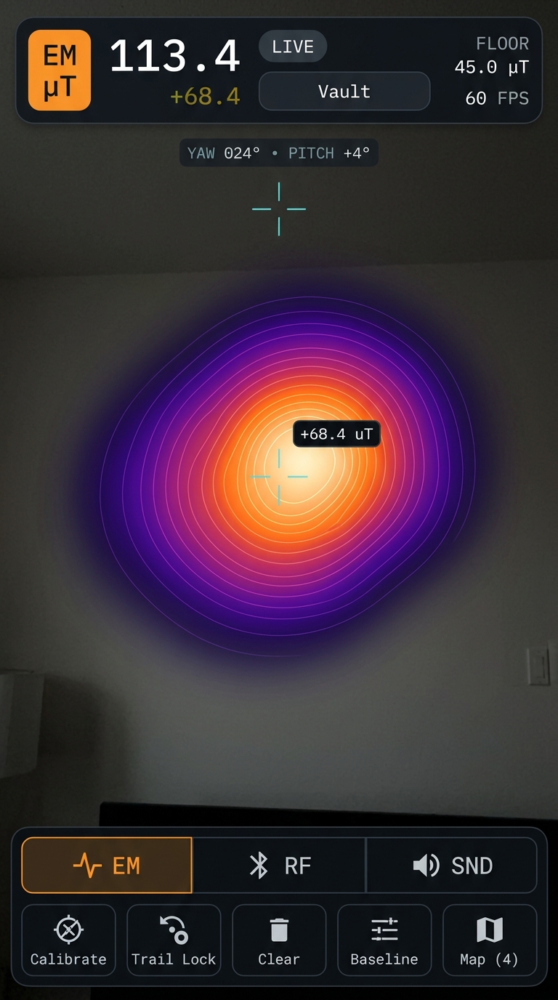
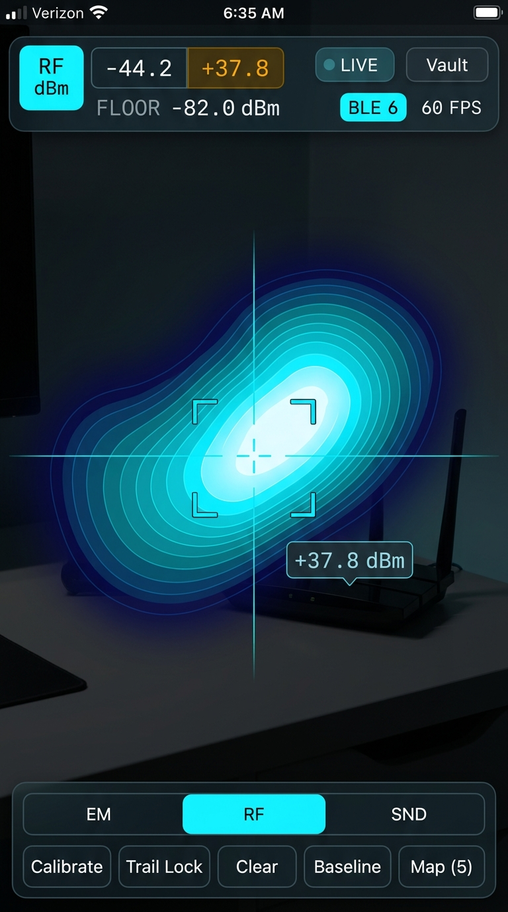
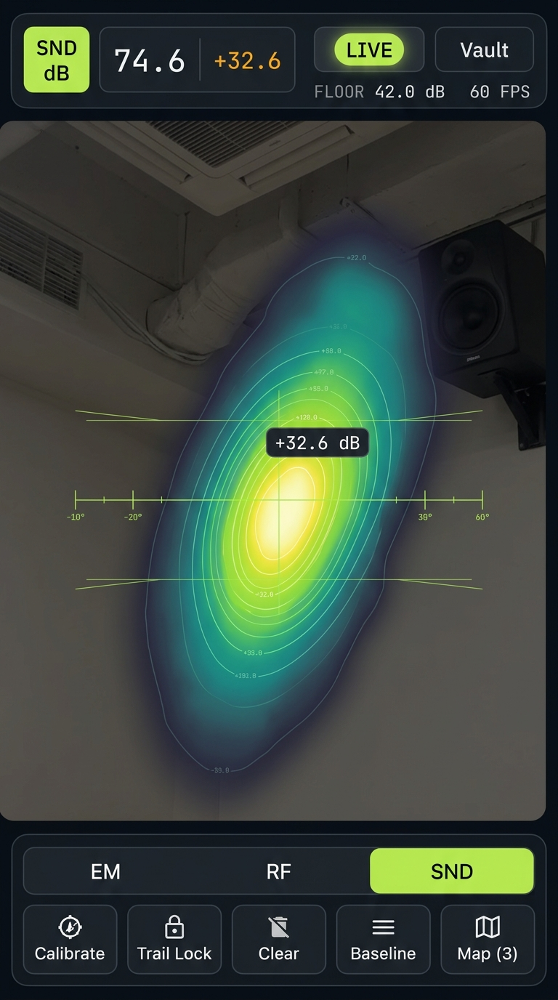
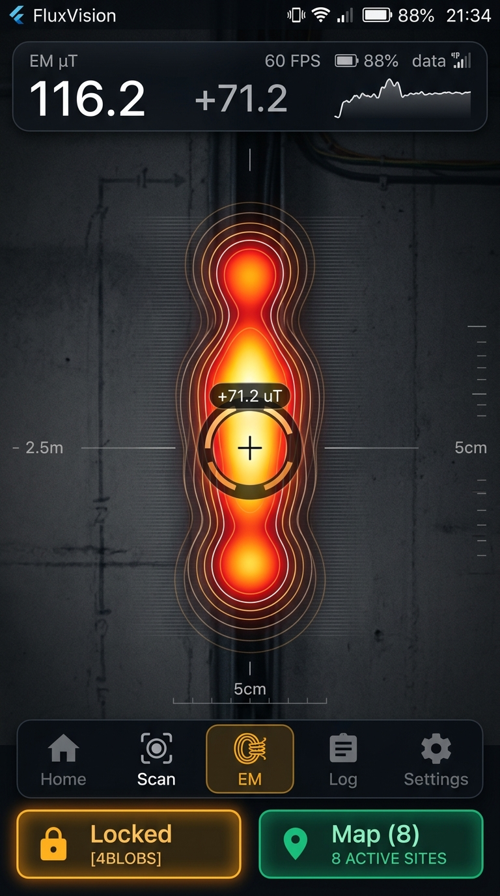
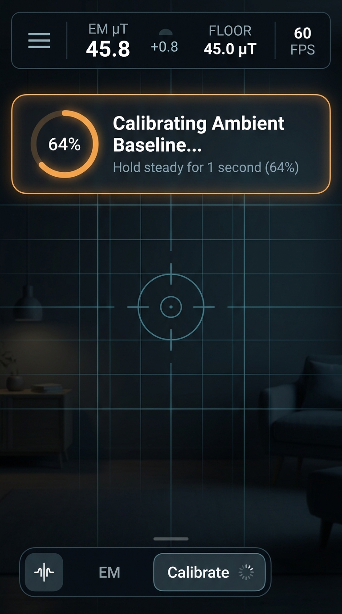
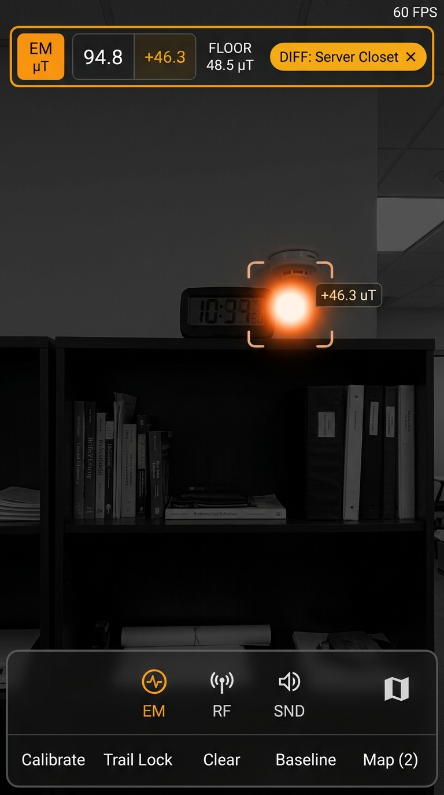
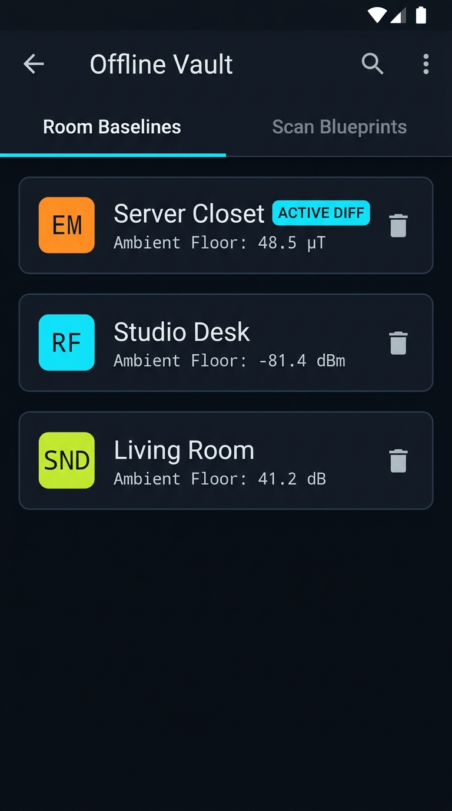
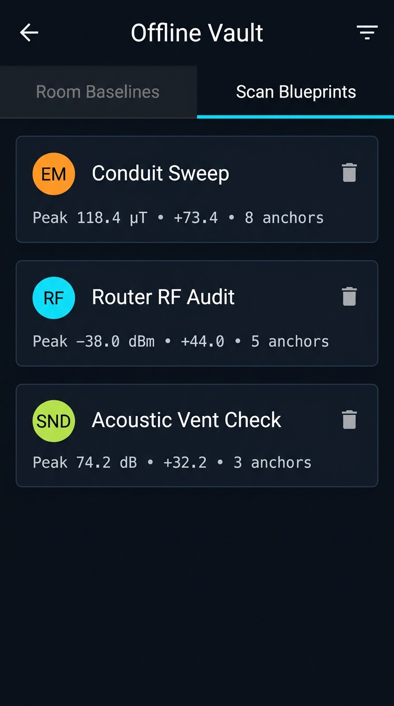
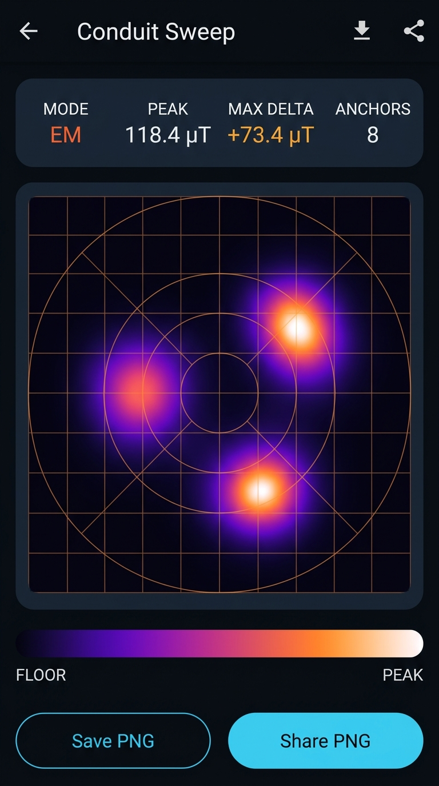
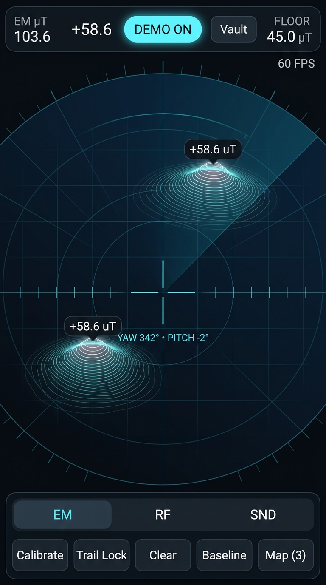

# FluxVision

**100% Pure Flutter offline AR electromagnetic, BLE RF, and acoustic spatial field scanner with real-time 3D thermal heatmaps, room baseline diffing, and 2D PNG blueprint export.**

FluxVision transforms a smartphone into an offline scientific field visualizer. Every piece of signal processing—1D Kalman filtering, 6-DOF complementary AHRS quaternion fusion, 3D spherical anomaly anchoring, perspective camera projection, GPU-accelerated additive thermal rendering, atomic binary vault storage, and 2D PNG blueprint generation—is written strictly in **pure Dart & Flutter** with zero cloud dependencies, zero web frameworks, and zero custom native/Rust bridges.

---

## Feature Showcase (10 Key Views)

> *Note: The showcase visuals below illustrate the 10 core FluxVision workflows and UI states implemented in `lib/`.*

| 1. EM Field AR Scanner | 2. BLE RF Spectrum Mode |
| :---: | :---: |
|  |  |
| Live magnetometer flux (`µT`) with Ironbow thermal blooms, iso-contour rings, and tabular HUD telemetry over hidden wiring. | Real-time Bluetooth LE RSSI (`dBm`) hotspot visualizer with Cyan-Plasma palette and live beacon counter (`BLE`). |

| 3. Acoustic Decibel Mode | 4. Persistent 3D Spatial Trail Lock |
| :---: | :---: |
|  |  |
| Directional microphone decibel (`dB`) Viridis-Sonar hotspot overlay (with `CameraController(enableAudio: false)` preventing mic locks). | Freezes exponential anchor decay so you can paint full wall conduits and room sweeps in 3D space. |

| 5. 1-Second Trimmed-Mean Calibration | 6. Room Baseline Privacy Diff Sweep |
| :---: | :---: |
|  |  |
| Collects 50 ambient samples, trims top/bottom 10% outliers, and locks the ambient floor automatically. | Loads any saved room baseline from the offline vault (`DIFF: <Room>`) to isolate newly introduced anomalies. |

| 7. Offline Vault — Room Baselines | 8. Offline Vault — Scan Blueprints |
| :---: | :---: |
|  |  |
| Atomic temp-file-then-rename JSON vault (`baselines.json`) with one-tap Privacy Diff activation and deletion. | Saved scan history (`sessions.json` + binary little-endian `Float32List` 32×32 grids) with peak telemetry summaries. |

| 9. Interactive 2D Blueprint & PNG Export | 10. Built-In 3D Demo Mode Sandbox |
| :---: | :---: |
|  |  |
| Pinch-zoomable 32×32 bilinear-smoothed top-down heatmap with offscreen `ui.PictureRecorder` PNG export and native share sheet. | Deterministic virtual 3D room simulator (`DEMO ON`) with touch-drag panning for emulators, desktops, or sensorless devices. |

---

## Architecture (100% Pure Flutter & Dart)

```text
flux_vision/
├── pubspec.yaml                              # Pure Flutter dependencies (zero codegen, zero web/JS)
├── analysis_options.yaml                     # Strict Dart typing & lint rules
├── android/                                  # Standard Flutter Android shell + hardware permissions
├── ios/                                      # Standard Flutter iOS shell + Info.plist usage strings
├── lib/
│   ├── main.dart                             # Portrait lock + ProviderScope bootstrap
│   ├── app/
│   │   ├── app.dart                          # MaterialApp.router root
│   │   ├── router.dart                       # go_router (/scanner, /vault, /blueprint/:id)
│   │   └── theme.dart                        # Tactical obsidian HUD theme & tabular monospace
│   ├── core/
│   │   ├── permissions/permission_service.dart
│   │   ├── storage/
│   │   │   ├── vault_models.dart             # Immutable RoomBaseline & ScanSession models
│   │   │   └── local_vault_storage.dart      # Atomic JSON + binary Float32List offline vault
│   │   └── utils/frame_metrics.dart          # Rolling EMA FPS & latency monitor
│   ├── engine/
│   │   ├── scan_mode.dart                    # EM / RF / Acoustic metadata & thermal palettes
│   │   ├── kalman_filter.dart                # Mode-tuned 1D Kalman filter
│   │   ├── orientation_tracker.dart          # 6-DOF complementary AHRS quaternion fusion
│   │   ├── spatial_field_engine.dart         # 3D anchors, decay, calibration & UV projection
│   │   ├── blueprint_mapper.dart             # 32x32 2-pass Gaussian top-down matrix builder
│   │   └── signal_isolate_worker.dart        # Background Dart Isolate DSP worker
│   ├── sensors/
│   │   ├── field_sensor_source.dart          # Sealed SensorPacket & FieldSensorSource contract
│   │   ├── live_sensor_source.dart           # sensors_plus + flutter_blue_plus + noise_meter
│   │   └── simulated_sensor_source.dart      # Virtual 3D room simulator for Demo Mode & tests
│   └── features/
│       ├── scanner/                          # ScannerScreen, Riverpod controller & HUD widgets
│       ├── vault/                            # VaultScreen & AsyncNotifier controller
│       └── blueprint/                        # BlueprintScreen & offscreen PNG exporter
├── test/                                     # 9 unit, isolate, storage, sensor & widget suites
└── docs/screenshots/                         # 10 feature showcase views
```

---

## Pure-Flutter Stack

- **State & Navigation:** `flutter_riverpod`, `go_router`
- **Live Hardware Sensors:** `camera`, `sensors_plus`, `flutter_blue_plus`, `noise_meter`, `permission_handler`
- **3D Math & Graphics:** `vector_math` + Flutter Impeller-accelerated `CustomPainter` (`BlendMode.plus`, `ui.Gradient.radial`, `ui.PictureRecorder`)
- **Offline Storage & Export:** `path_provider`, `path`, `share_plus`

---

## Getting Started & Verification

Ensure you have **Flutter `>=3.44.0`** and **Dart `>=3.12.0`** installed:

```bash
# 1. Install Dart/Flutter packages
flutter pub get

# 2. Run strict static analysis (0 errors / 0 infos)
flutter analyze --fatal-infos

# 3. Run all 9 automated unit, isolate, storage & widget test suites
flutter test

# 4. Launch on a physical device (or emulator with built-in Demo Mode)
flutter run --profile
```

### Automated Test Suites (`test/`)

| Suite | Coverage |
| :--- | :--- |
| `test/engine/kalman_filter_test.dart` | High-frequency sine jitter suppression, +120 µT step convergence, reset behavior |
| `test/engine/orientation_tracker_test.dart` | Unit quaternion normalization, 90° yaw integration, complementary gravity correction |
| `test/engine/spatial_field_engine_test.dart` | Trimmed-mean calibration outlier rejection, UV bounds, camera culling, trail lock, 32×32 grid |
| `test/engine/signal_isolate_worker_test.dart` | Real background Dart `Isolate` round-trip processing and 32×32 blueprint export |
| `test/sensors/simulated_sensor_source_test.dart` | EM / RF / Acoustic packet emission cadence, pan bounds, clean stream shutdown |
| `test/storage/local_vault_storage_test.dart` | Atomic JSON baselines and little-endian `Float32List(1024)` binary grid round-trips |
| `test/features/scanner/scanner_controller_test.dart` | Live packet ingestion, permission alerts, Privacy Diff activation, snapshot export & disposal |
| `test/widget/scanner_hud_test.dart` | Full `ScannerScreen` Demo Mode HUD rendering, mode switching, Trail Lock & calibration |
| `test/widget/vault_blueprint_test.dart` | `VaultScreen` tabs, `BlueprintScreen` rendering, bilinear interpolation & color palette math |
